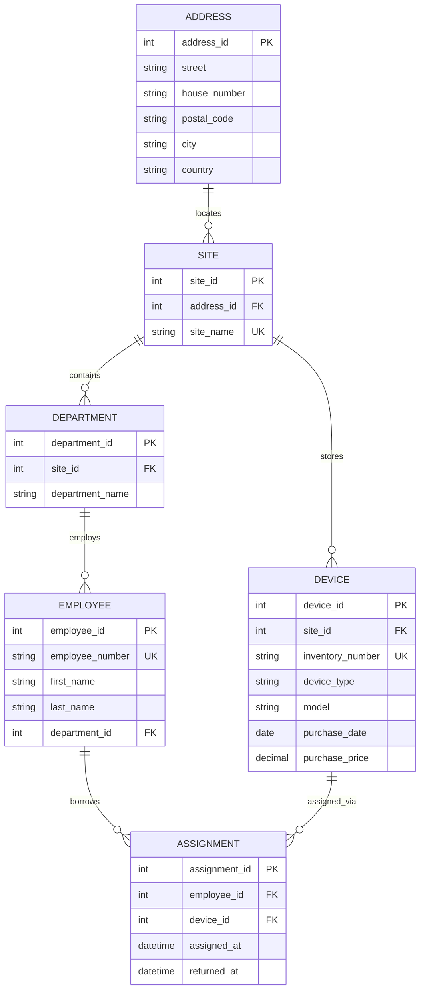

# Domänenmodell Inventar

## ER-Modell

## Konzeptionelles ER-Modell

## Fachregeln

- **R1:** Ein Gerät darf gleichzeitig höchstens eine aktive Ausleihe besitzen.
- **R2:** Eine aktive Ausleihe besitzt kein Rückgabedatum.
- **R3:** Das Rückgabedatum darf nicht vor dem Ausgabedatum liegen.
- **R4:** Abgeschlossene Ausleihen bleiben zur Abbildung der Historie erhalten.
- **R5:** Mitarbeitende gehören einer Abteilung an; Geräte sind einem Standort zugeordnet.

## Constraints / UK-Ideen

- `SITE.site_name` → `UNIQUE`
- `EMPLOYEE.employee_number` → `UNIQUE`
- `DEVICE.inventory_number` → `UNIQUE`
- `(DEPARTMENT.site_id, DEPARTMENT.department_name)` → `UNIQUE`
- `ASSIGNMENT.employee_id` → `FOREIGN KEY` auf `EMPLOYEE.employee_id`
- `ASSIGNMENT.device_id` → `FOREIGN KEY` auf `DEVICE.device_id`
- `CHECK (returned_at IS NULL OR returned_at >= assigned_at)`
- Pro `device_id` darf maximal eine aktive `ASSIGNMENT` mit `returned_at IS NULL` existieren.