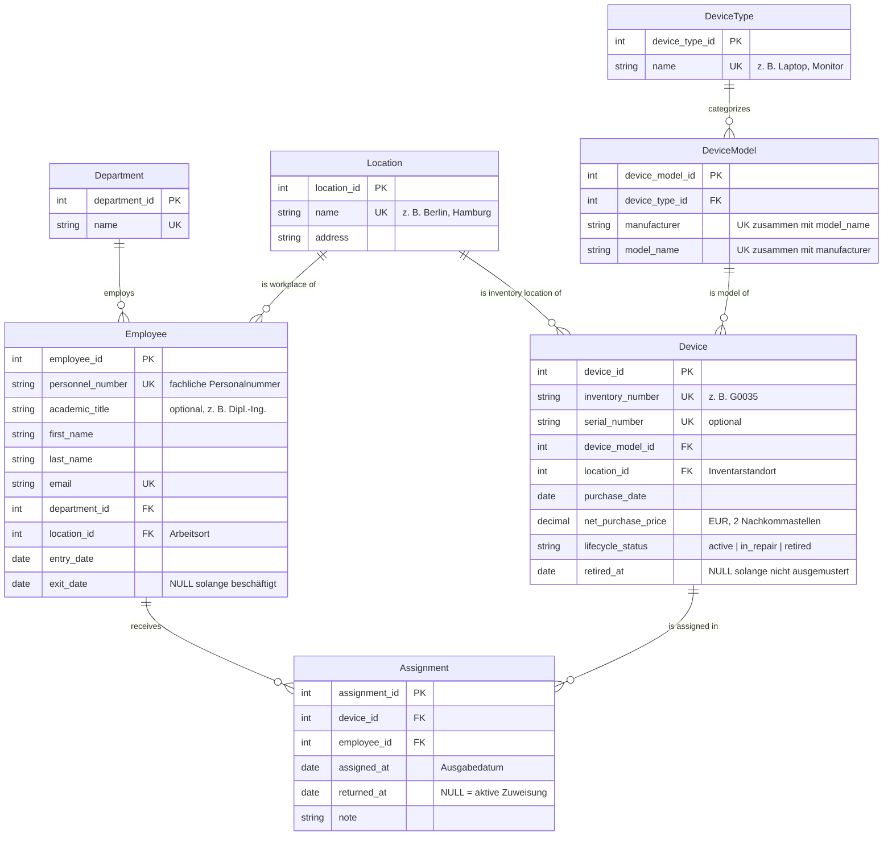

# Domänenmodell: Geräteausleihe

## 1. Entitäten

| Entität | Beschreibung |
|---|---|
| `Employee` | Mitarbeitende Person, die Geräte ausleihen kann. |
| `Department` | Abteilung, der Mitarbeitende zugeordnet sind (z. B. IT, Vertrieb, Marketing, Produktion). |
| `Location` | Standort des Unternehmens (z. B. Berlin, Hamburg, München). |
| `DeviceType` | Kategorie von Geräten (z. B. Laptop, Monitor, Beamer). |
| `DeviceModel` | Konkretes Hersteller-Modell (z. B. Dell XPS, Canon Pixma), gehört zu genau einem Gerätetyp. |
| `Device` | Physisches, inventarisiertes Einzelgerät mit Inventarnummer, Kaufdaten und Lebenszyklusstatus. |
| `Assignment` | Eine Ausleihe: Zuweisung eines Geräts an eine Person für einen Zeitraum. Bildet die Historie. |

## 2. ER-Diagramm

## 3. Fachregeln

Die folgenden Regeln lassen sich im ERD nicht ausdrücken. Sie müssen über Constraints, Trigger oder die Anwendungslogik durchgesetzt werden.

**R1 – Höchstens eine aktive Zuweisung pro Gerät.**
Ein Gerät darf zu jedem Zeitpunkt höchstens eine Zuweisung mit `returned_at IS NULL` haben.
*Anlass: In den Excel-Daten hatte z. B. G0035 drei gleichzeitig offene Ausleihen.*

**R2 – Keine überlappenden Zuweisungen.**
Die Zeiträume `[assigned_at, returned_at)` aller Zuweisungen desselben Geräts dürfen sich nicht überschneiden, auch nicht bei bereits abgeschlossenen Zuweisungen. R1 ist ein Spezialfall dieser Regel.
*Anlass: G0005 wurde vom 23.08.25 bis 22.09.25 verliehen, obwohl eine Ausleihe seit 07.04.24 noch offen war.*

**R3 – Rückgabe nicht vor Ausgabe.**
Wenn `returned_at` gesetzt ist, gilt `returned_at >= assigned_at`.

**R4 – Keine Ausgabe vor dem Kauf.**
`Assignment.assigned_at >= Device.purchase_date`.
*Anlass: G0011, G0022 und G0031 wurden laut Excel-Daten vor ihrem Kaufdatum ausgegeben.*

**R5 – Keine Daten in der Zukunft.**
`assigned_at` und `returned_at` dürfen nicht nach dem aktuellen Datum liegen. Geplante, zukünftige Ausgaben sind nicht Teil dieses Modells.

**R6 – Nur einsatzbereite Geräte werden ausgegeben.**
Eine neue Zuweisung ist nur für Geräte mit `lifecycle_status = 'active'` erlaubt. Umgekehrt darf ein Gerät mit aktiver Zuweisung nicht auf `in_repair` oder `retired` gesetzt werden; es muss zuerst zurückgegeben werden.

**R7 – Zuweisungen nur während der Beschäftigung.**
Es gilt `assigned_at >= Employee.entry_date`. Neue Zuweisungen an Personen mit gesetztem `exit_date` sind nicht erlaubt, und beim Austritt müssen alle Zuweisungen zurückgegeben sein (`returned_at <= exit_date`).

**R8 – Ausmusterung nach Kauf und nach letzter Rückgabe.**
`retired_at >= purchase_date` und `retired_at` liegt nicht vor der letzten Rückgabe des Geräts.

**R9 – Die Ausleihhistorie ist unveränderlich.**
Zuweisungen werden nicht gelöscht. Die einzige reguläre Änderung an einer bestehenden Zuweisung ist das einmalige Setzen von `returned_at`. Korrekturen von Erfassungsfehlern müssen nachvollziehbar sein (z. B. über ein Änderungsprotokoll).

**R10 – Stammdaten mit Historie werden nicht gelöscht.**
Mitarbeitende, Geräte, Modelle, Typen, Abteilungen und Standorte, auf die eine Zuweisung oder ein anderer Datensatz verweist, dürfen nicht gelöscht werden.

**R11 – Gerätestandort und Arbeitsort dürfen abweichen.**
`Device.location_id` bezeichnet den Inventarstandort, also wo das Gerät geführt wird und wohin es zurückgegeben wird. Eine Person aus Hamburg darf ein in München inventarisiertes Gerät ausleihen. Dies ist eine bewusste Festlegung, damit Abweichungen wie in den Excel-Daten nicht als Fehler gelten.

**R12 – Preise werden einheitlich gespeichert.**
Der Kaufpreis wird netto in Euro mit zwei Nachkommastellen gespeichert und ist nicht negativ. Beim Import ist das Dezimaltrennzeichen der Quelle explizit festzulegen.
*Anlass: In den CSV-Dateien wurden Punkte als Dezimaltrennzeichen falsch interpretiert, wodurch Preise um den Faktor 100 zu hoch waren.*