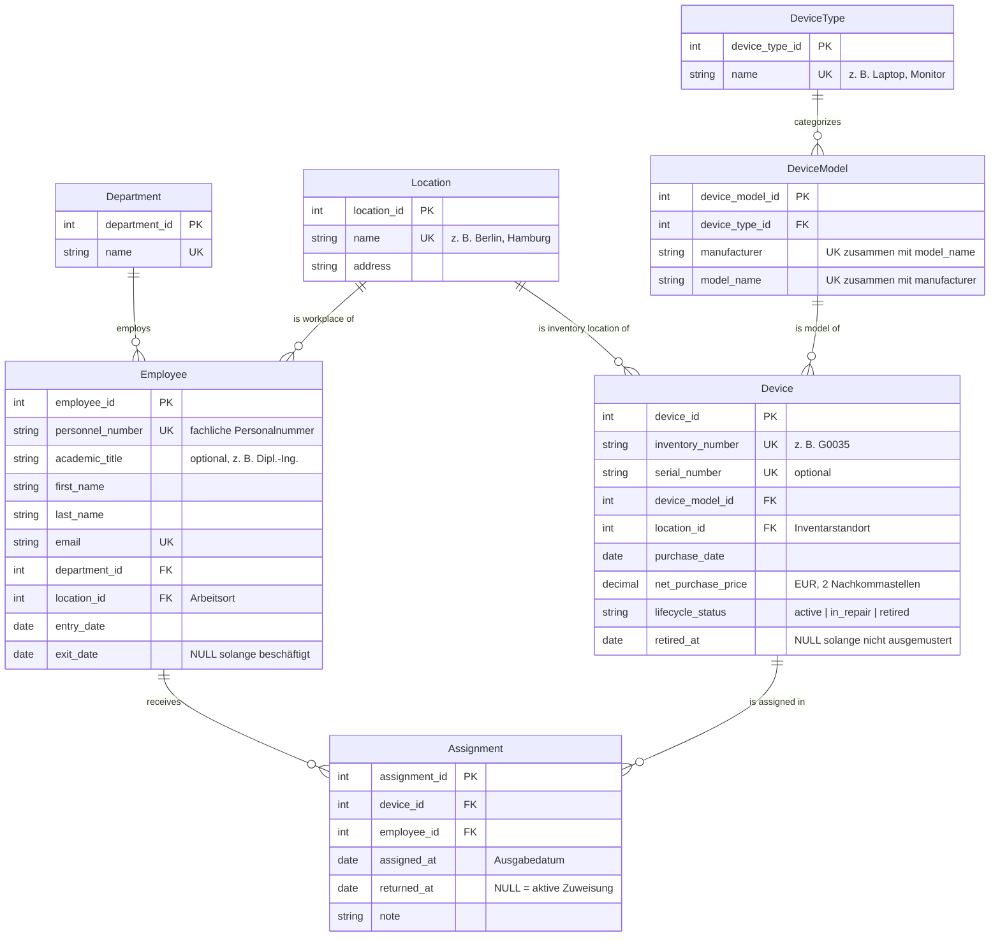

# Domänenmodell: Geräteausleihe

## 1. Kontext

Ein Unternehmen verwaltet Geräte wie Laptops, Monitore, Smartphones, Tablets, Drucker und Beamer. Diese Geräte werden an Mitarbeitende ausgegeben und später wieder zurückgegeben. Das Datenmodell soll die Stammdaten (Mitarbeitende, Geräte, Organisationsstruktur) sowie die vollständige Historie aller Ausleihen abbilden.

Typische Fragen, die das Modell beantworten können muss:

- Welche Geräte hat eine Person aktuell?
- Wer hat ein bestimmtes Gerät gerade, und wer hatte es wann vorher?
- Welche Geräte sind aktuell frei und können ausgegeben werden?
- Welcher Gesamtwert ist im Einsatz bzw. nicht im Einsatz?
- Wie verteilen sich die Ausleihen auf Gerätetypen und Standorte?

## 2. Abgrenzung zu den Excel-Daten aus Tag 1

Die zusammengeführte Excel-Tabelle diente als Inspiration, wird aber bewusst nicht 1:1 nachgebaut. Die wesentlichen Unterschiede:

- **Redundanzen aufgelöst:** In der Gesamttabelle wiederholen sich Modell, Kaufdatum, Preis, Name und Abteilung in jeder Ausleihzeile. Im Modell stehen diese Informationen genau einmal in der jeweiligen Stammdaten-Entität.
- **Gerätetyp hängt am Modell:** Ein „Dell XPS" ist immer ein Laptop. Der Typ wird deshalb über das Gerätemodell zugeordnet und nicht pro Gerät oder Ausleihe gepflegt.
- **Standort als eigene Entität:** Die Excel-Daten hatten zwei Freitext-Spalten (`Standort` und `Standort_MA`). Im Modell gibt es eine Entität `Location`, auf die sowohl Geräte als auch Mitarbeitende verweisen.
- **Name aufgeteilt:** Statt eines Freitextfeldes wie „Dipl.-Ing. Klaus …" gibt es Titel, Vorname und Nachname.
- **Technische und fachliche Schlüssel getrennt:** Jede Entität hat einen technischen Primärschlüssel. Fachliche Kennungen wie die Inventarnummer `G0035` oder die Personalnummer `1009` sind eindeutige, aber separate Attribute.
- **Datenqualitätsprobleme als Regeln:** In den Excel-Daten gab es mehrere gleichzeitig offene Ausleihen desselben Geräts, Ausgaben vor dem Kaufdatum und Preise mit falschem Dezimaltrennzeichen. Daraus sind die Regeln in Abschnitt 6 entstanden.

## 3. Entitäten

| Entität | Beschreibung |
|---|---|
| `Employee` | Mitarbeitende Person, die Geräte ausleihen kann. |
| `Department` | Abteilung, der Mitarbeitende zugeordnet sind (z. B. IT, Vertrieb, Marketing, Produktion). |
| `Location` | Standort des Unternehmens (z. B. Berlin, Hamburg, München). |
| `DeviceType` | Kategorie von Geräten (z. B. Laptop, Monitor, Beamer). |
| `DeviceModel` | Konkretes Hersteller-Modell (z. B. Dell XPS, Canon Pixma), gehört zu genau einem Gerätetyp. |
| `Device` | Physisches, inventarisiertes Einzelgerät mit Inventarnummer, Kaufdaten und Lebenszyklusstatus. |
| `Assignment` | Eine Ausleihe: Zuweisung eines Geräts an eine Person für einen Zeitraum. Bildet die Historie. |

## 4. ER-Diagramm



### Kardinalitäten im Überblick

Eine Abteilung hat beliebig viele Mitarbeitende, jede Person gehört zu genau einer Abteilung. Gleiches gilt für den Standort als Arbeitsort. Ein Standort kann außerdem Inventarstandort beliebig vieler Geräte sein, jedes Gerät hat genau einen Inventarstandort.

Ein Gerätetyp umfasst beliebig viele Modelle, jedes Modell gehört zu genau einem Typ. Von einem Modell kann es beliebig viele physische Geräte geben.

`Assignment` löst die n:m-Beziehung zwischen `Employee` und `Device` auf: Eine Person kann im Lauf der Zeit viele Geräte ausleihen, und ein Gerät kann nacheinander an viele Personen gehen. Jede Zuweisung bezieht sich auf genau ein Gerät und genau eine Person.

## 5. Bewusste Modellierungsentscheidungen

- **Der Ausleihstatus wird nicht gespeichert, sondern abgeleitet.** Ob ein Gerät gerade ausgeliehen ist, ergibt sich ausschließlich aus der Existenz einer `Assignment` mit `returned_at IS NULL`. `lifecycle_status` beschreibt nur den davon unabhängigen Zustand des Geräts (einsatzbereit, in Reparatur, ausgemustert). So können die beiden Informationen nicht auseinanderlaufen.
- **Kein Löschen, sondern Deaktivieren.** Mitarbeitende werden über `exit_date`, Geräte über `lifecycle_status = 'retired'` und `retired_at` aus dem aktiven Bestand genommen. Die Historie bleibt dadurch vollständig erhalten.
- **Datum statt Zeitstempel.** Ausgabe und Rückgabe werden tagesgenau erfasst, wie in den Ausgangsdaten. Wird später eine höhere Genauigkeit benötigt, können die Felder auf `timestamp` umgestellt werden, ohne dass sich die Regeln ändern.

## 6. Fachregeln

Die folgenden Regeln lassen sich im ERD nicht ausdrücken. Sie müssen über Constraints, Trigger oder die Anwendungslogik durchgesetzt werden.

**R1 – Höchstens eine aktive Zuweisung pro Gerät.**
Ein Gerät darf zu jedem Zeitpunkt höchstens eine Zuweisung mit `returned_at IS NULL` haben.
*Anlass: In den Excel-Daten hatte z. B. G0035 drei gleichzeitig offene Ausleihen.*

**R2 – Keine überlappenden Zuweisungen.**
Die Zeiträume `[assigned_at, returned_at)` aller Zuweisungen desselben Geräts dürfen sich nicht überschneiden, auch nicht bei bereits abgeschlossenen Zuweisungen. R1 ist ein Spezialfall dieser Regel.
*Anlass: G0005 wurde vom 23.08.25 bis 22.09.25 verliehen, obwohl eine Ausleihe seit 07.04.24 noch offen war.*

**R3 – Rückgabe nicht vor Ausgabe.**
Wenn `returned_at` gesetzt ist, gilt `returned_at >= assigned_at`.

**R4 – Keine Ausgabe vor dem Kauf.**
`Assignment.assigned_at >= Device.purchase_date`.
*Anlass: G0011, G0022 und G0031 wurden laut Excel-Daten vor ihrem Kaufdatum ausgegeben.*

**R5 – Keine Daten in der Zukunft.**
`assigned_at` und `returned_at` dürfen nicht nach dem aktuellen Datum liegen. Geplante, zukünftige Ausgaben sind nicht Teil dieses Modells.

**R6 – Nur einsatzbereite Geräte werden ausgegeben.**
Eine neue Zuweisung ist nur für Geräte mit `lifecycle_status = 'active'` erlaubt. Umgekehrt darf ein Gerät mit aktiver Zuweisung nicht auf `in_repair` oder `retired` gesetzt werden; es muss zuerst zurückgegeben werden.

**R7 – Zuweisungen nur während der Beschäftigung.**
Es gilt `assigned_at >= Employee.entry_date`. Neue Zuweisungen an Personen mit gesetztem `exit_date` sind nicht erlaubt, und beim Austritt müssen alle Zuweisungen zurückgegeben sein (`returned_at <= exit_date`).

**R8 – Ausmusterung nach Kauf und nach letzter Rückgabe.**
`retired_at >= purchase_date` und `retired_at` liegt nicht vor der letzten Rückgabe des Geräts.

**R9 – Die Ausleihhistorie ist unveränderlich.**
Zuweisungen werden nicht gelöscht. Die einzige reguläre Änderung an einer bestehenden Zuweisung ist das einmalige Setzen von `returned_at`. Korrekturen von Erfassungsfehlern müssen nachvollziehbar sein (z. B. über ein Änderungsprotokoll).

**R10 – Stammdaten mit Historie werden nicht gelöscht.**
Mitarbeitende, Geräte, Modelle, Typen, Abteilungen und Standorte, auf die eine Zuweisung oder ein anderer Datensatz verweist, dürfen nicht gelöscht werden.

**R11 – Gerätestandort und Arbeitsort dürfen abweichen.**
`Device.location_id` bezeichnet den Inventarstandort, also wo das Gerät geführt wird und wohin es zurückgegeben wird. Eine Person aus Hamburg darf ein in München inventarisiertes Gerät ausleihen. Dies ist eine bewusste Festlegung, damit Abweichungen wie in den Excel-Daten nicht als Fehler gelten.

**R12 – Preise werden einheitlich gespeichert.**
Der Kaufpreis wird netto in Euro mit zwei Nachkommastellen gespeichert und ist nicht negativ. Beim Import ist das Dezimaltrennzeichen der Quelle explizit festzulegen.
*Anlass: In den CSV-Dateien wurden Punkte als Dezimaltrennzeichen falsch interpretiert, wodurch Preise um den Faktor 100 zu hoch waren.*

## 7. UK- und Constraint-Ideen

| Tabelle | Constraint | Art | Regel |
|---|---|---|---|
| `Employee` | `personnel_number` eindeutig | UNIQUE | – |
| `Employee` | `email` eindeutig | UNIQUE | – |
| `Employee` | `exit_date IS NULL OR exit_date >= entry_date` | CHECK | – |
| `Department` | `name` eindeutig | UNIQUE | – |
| `Location` | `name` eindeutig | UNIQUE | – |
| `DeviceType` | `name` eindeutig | UNIQUE | – |
| `DeviceModel` | `(manufacturer, model_name)` eindeutig | UNIQUE (zusammengesetzt) | – |
| `Device` | `inventory_number` eindeutig | UNIQUE | – |
| `Device` | `serial_number` eindeutig, sofern vorhanden | UNIQUE (NULL erlaubt) | – |
| `Device` | `net_purchase_price >= 0` | CHECK | R12 |
| `Device` | `lifecycle_status IN ('active', 'in_repair', 'retired')` | CHECK | R6 |
| `Device` | `retired_at` gesetzt genau dann, wenn Status `retired` | CHECK | R8 |
| `Device` | `retired_at IS NULL OR retired_at >= purchase_date` | CHECK | R8 |
| `Assignment` | `returned_at IS NULL OR returned_at >= assigned_at` | CHECK | R3 |
| `Assignment` | höchstens eine Zeile mit `returned_at IS NULL` je `device_id` | Partieller UNIQUE-Index | R1 |
| `Assignment` | keine überlappenden Zeiträume je `device_id` | Exclusion Constraint | R2 |
| alle FKs | `ON DELETE RESTRICT` | Fremdschlüssel | R10 |

Regeln, die mehrere Tabellen betreffen (R4, R6, R7, R8 teilweise) oder vom aktuellen Datum abhängen (R5), lassen sich nicht als einfacher CHECK-Constraint formulieren. Sie werden über Trigger oder in der Anwendungslogik geprüft. R9 kann über eingeschränkte Rechte (kein `DELETE` auf `Assignment`) und einen Trigger abgesichert werden, der Änderungen außer dem Setzen von `returned_at` verhindert.

### Beispielumsetzung in PostgreSQL

```sql
-- R3: Rückgabe nicht vor Ausgabe
ALTER TABLE assignment
    ADD CONSTRAINT chk_assignment_dates
    CHECK (returned_at IS NULL OR returned_at >= assigned_at);

-- R1: höchstens eine aktive Zuweisung pro Gerät
CREATE UNIQUE INDEX uq_assignment_active_device
    ON assignment (device_id)
    WHERE returned_at IS NULL;

-- R2: keine überlappenden Zuweisungen desselben Geräts
CREATE EXTENSION IF NOT EXISTS btree_gist;

ALTER TABLE assignment
    ADD CONSTRAINT excl_assignment_no_overlap
    EXCLUDE USING gist (
        device_id WITH =,
        daterange(assigned_at, returned_at, '[)') WITH &&
    );

-- R12: Preis nicht negativ
ALTER TABLE device
    ADD CONSTRAINT chk_device_price
    CHECK (net_purchase_price >= 0);
```

Bei `daterange(assigned_at, NULL, '[)')` ist die Obergrenze unbegrenzt. Eine offene Zuweisung blockiert das Gerät damit für alle späteren Zeiträume, wodurch der Exclusion Constraint auch R1 bereits abdeckt. Der partielle Index ist trotzdem sinnvoll, weil er die Abfrage „aktuelle Zuweisung eines Geräts" beschleunigt.

## 8. Annahmen und offene Fragen

- Es gibt keine Obergrenze, wie viele Geräte eine Person gleichzeitig haben darf. Falls fachlich gewünscht (z. B. höchstens ein Laptop pro Person), wäre das eine zusätzliche Regel.
- Personen wechseln Abteilung und Standort im Modell ohne Historie; gespeichert wird nur der aktuelle Stand. Soll nachvollziehbar sein, in welcher Abteilung jemand zum Zeitpunkt einer Ausleihe war, bräuchte es eine Historisierung dieser Zuordnung.
- Reparaturen werden nur als Status abgebildet, nicht als eigene Historie. Bei Bedarf könnte eine Entität `MaintenanceEvent` ergänzt werden.
- Wer eine Ausgabe durchgeführt hat (z. B. IT-Support), wird nicht erfasst.